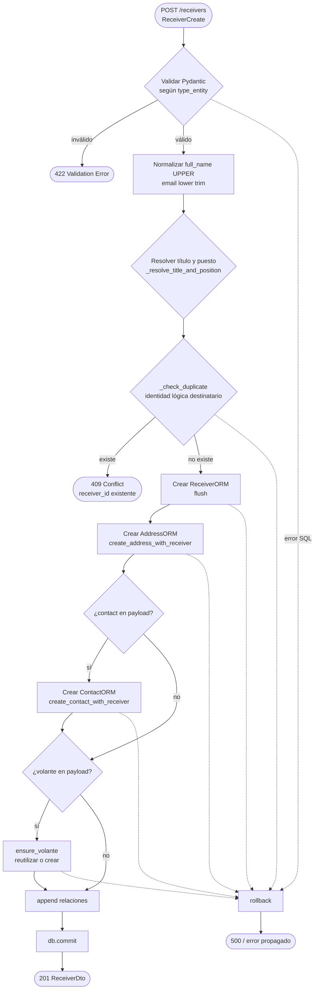
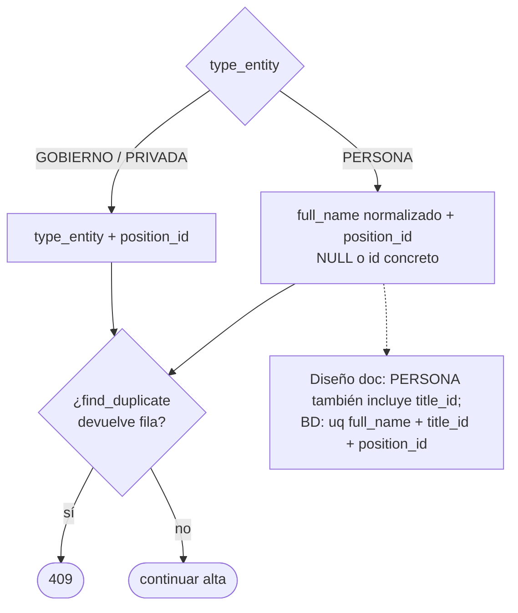
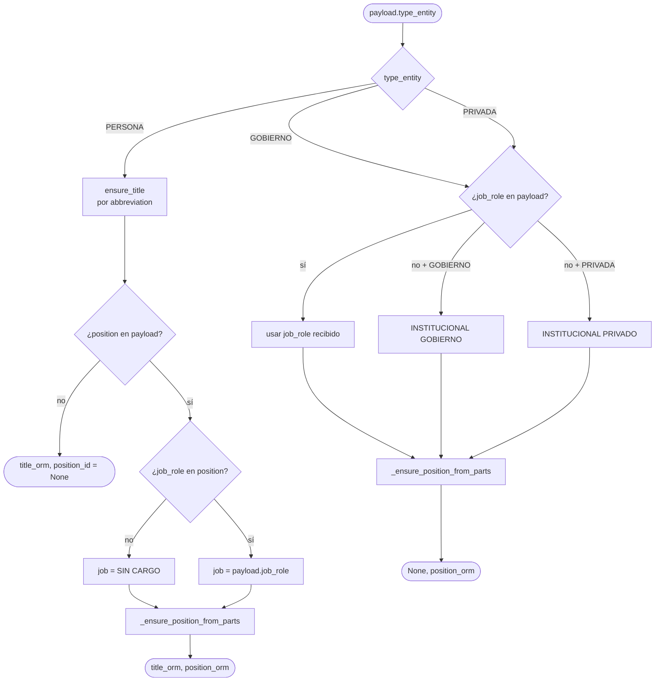
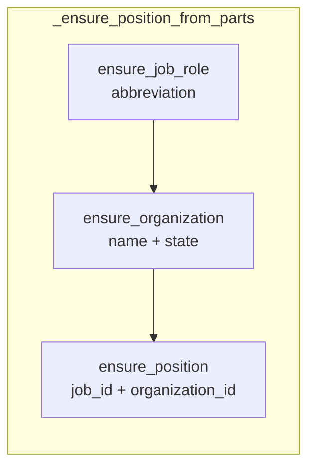
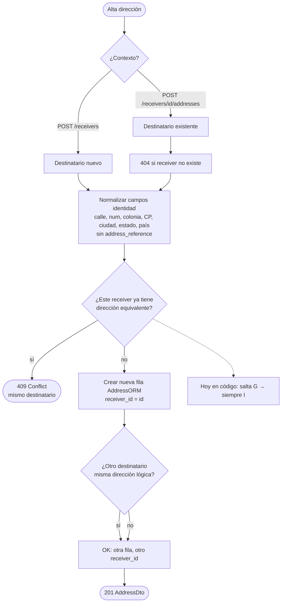
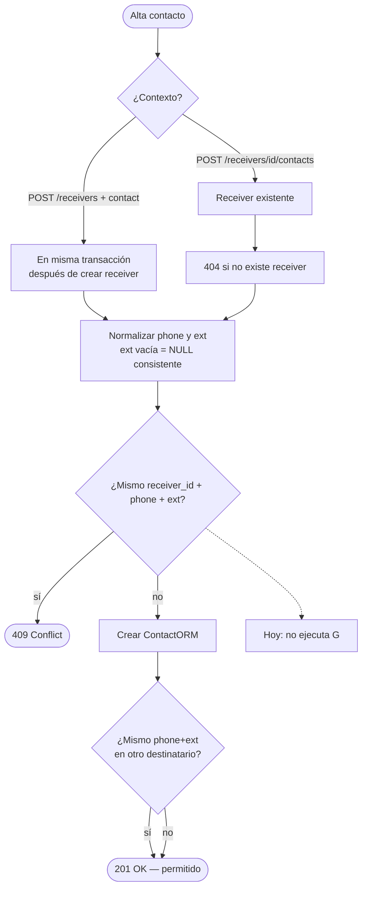
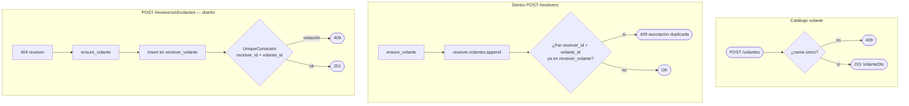
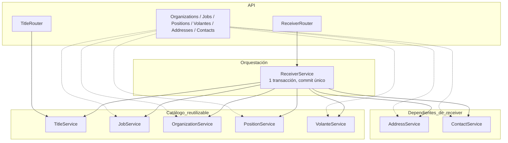

# Flujos de creación — destinatarios y entidades relacionadas

Documento de referencia con diagramas Mermaid. Combina el comportamiento **actual** del código (`ReceiverService`, `ensure_*`) y las reglas del diseño en `DISENO_API_DESTINATARIOS.md` (verificación de dirección y contacto **por destinatario**, aún no implementada en servicios).

## Modelo de datos (lectura de los diagramas)

| Entidad | ¿Catálogo reutilizable? | Relación con destinatario |
|--------|-------------------------|---------------------------|
| Título, cargo, organización, puesto, volante | Sí (buscar o crear) | Puesto en `receiver.position_id`; volante **N:N** (`receiver_volante`) |
| Dirección, contacto | No tienen sentido “sueltos” en negocio | **FK obligatorio** a `receivers`; hoy siempre se crea fila nueva al alta |
| Dirección “compartida” entre destinatarios | Mismo texto en **filas distintas** | OK entre destinatarios; **409** si el **mismo** destinatario repite domicilio equivalente (diseño) |
| Contacto | Igual | **409** si mismo `phone` + misma `ext` (normalizados) en el **mismo** destinatario; otra `ext` sí es válida (diseño) |

---

## 1. Creación compuesta — `POST /receivers`

### Identidad duplicado destinatario (repositorio)

---

## 2. Resolución de título y puesto (alta compuesta)

---

## 3. Patrón **ensure** (reutilización en alta compuesta)

En el alta compuesta **no hay commit** en estos servicios; usan `flush` donde hace falta el id.

```mermaid
flowchart TD
    subgraph TITULO["TitleService.ensure_title"]
        T1[Buscar por abbreviation] --> T2{¿existe?}
        T2 -->|sí| T3[Retornar TitleORM]
        T2 -->|no| T4[Crear + flush]
    end

    subgraph CARGO["JobService.ensure_job_role"]
        J1[Buscar por abbreviation] --> J2{¿existe?}
        J2 -->|sí| J3[Retornar JobRoleORM]
        J2 -->|no| J4[Crear sin commit]
    end

    subgraph ORG["OrganizationService.ensure_organization"]
        O1[Buscar name + state] --> O2{¿existe?}
        O2 -->|sí| O3[Retornar OrganizationORM]
        O2 -->|no| O4[Crear sin commit]
    end

    subgraph PUESTO["PositionService.ensure_position"]
        P1[Buscar job_id + organization_id] --> P2{¿existe?}
        P2 -->|sí| P3[Retornar PositionORM]
        P2 -->|no| P4[Crear sin commit]
    end

    subgraph VOL["VolanteService.ensure_volante"]
        V1[Buscar por name] --> V2{¿existe?}
        V2 -->|sí| V3[Retornar VolanteORM]
        V2 -->|no| V4[Crear + flush]
    end
```

---

## 4. Creación **explícita** por catálogo (endpoints separados)

Comportamiento **distinto** de `ensure`: si ya existe, **error** (no reutilizar silenciosamente).

```mermaid
flowchart TD
    subgraph POST_TITLE["POST /titles — implementado"]
        PT1[Buscar abbreviation] --> PT2{¿existe?}
        PT2 -->|sí| PT409([409 El título ya existe])
        PT2 -->|no| PT201([201 TitleDto + commit])
    end

    subgraph POST_JOB["POST /job_roles — implementado en service"]
        PJ1[Buscar abbreviation] --> PJ2{¿existe?}
        PJ2 -->|sí| PJ400([400 already exists])
        PJ2 -->|no| PJ201([201 JobDto + commit])
    end

    subgraph POST_ORG["POST /organizations — implementado"]
        PO1[find name + state] --> PO2{¿existe?}
        PO2 -->|sí| PO400([400 Organization already exists])
        PO2 -->|no| PO201([201 OrganizationDto + commit])
    end

    subgraph POST_POS["POST /positions — implementado"]
        PP1[¿existen job y org?] --> PP2{404 si falta alguno}
        PP2 --> PP3[find_position job+org]
        PP3 --> PP4{¿puesto existe?}
        PP4 -->|sí| PP409([409 Position already exists])
        PP4 -->|no| PP201([201 PositionDto + commit])
    end

    subgraph POST_VOL["POST /volantes — implementado"]
        PV1[get_by_name] --> PV2{¿existe?}
        PV2 -->|sí| PV409([409 Volante ya existe])
        PV2 -->|no| PV201([201 VolanteDto + commit])
    end
```

**Cuándo usar qué:**

- **Alta masiva / formulario destinatario** → `ensure_*` dentro de `POST /receivers`.
- **Catálogo curado por operador** → `POST` explícito; luego en destinatarios solo referencias (p. ej. `create_position` exige cargo y org ya creados).

---

## 5. Direcciones — flujo objetivo (diseño) vs hoy

**Hoy:** `create_address_with_receiver` siempre instancia `AddressORM` sin comparar duplicados en el mismo destinatario. `POST /addresses` crea fila sin asignar destinatario en el flujo compuesto; el modelo exige `receiver_id`.

---

## 6. Contactos — flujo objetivo (diseño) vs hoy

**Hoy:** siempre crea `ContactORM` nuevo; no hay chequeo `phone + ext` por destinatario.

---

## 7. Volantes — catálogo + asociación

---

## 8. Vista de capas

---

## Backlog resumido

1. **Ya orquestado:** título, cargo, org, puesto, volante (`ensure`), destinatario, dirección y contacto en una transacción.
2. **Pendiente (diseño):** `find_duplicate_address_for_receiver`, `find_duplicate_contact_for_receiver`; endpoints `POST /receivers/{id}/addresses|contacts|volantes`.
3. **Alinear:** duplicado PERSONA con `title_id` en repositorio (diseño y `uq_receiver_name_position` en BD).
4. **Volante en alta:** se resuelve después de crear el receiver; equivalente funcional si todo va en la misma transacción.
