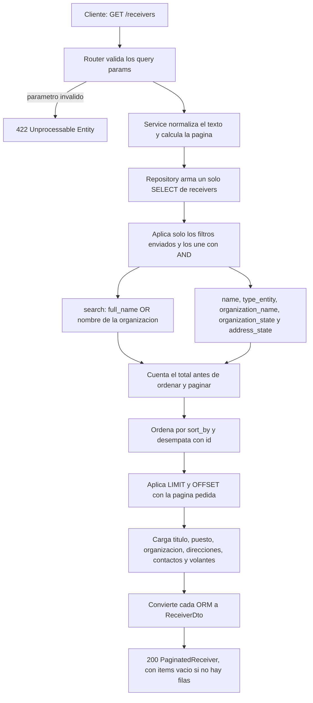

# Modificaciones de la búsqueda de destinatarios

Diagnóstico de `GET /receivers` frente a `DISENO_API_DESTINATARIOS.md`.
La búsqueda todavía no está alineada con el diseño: el listado responde 500
cuando encuentra filas, y la búsqueda por organización responde 200 con la
lista vacía aunque el destinatario exista.

Comprobado contra la base local: 5 destinatarios (3 `PERSONA` y 2 `GOBIERNO`).

## Flujo de búsqueda

El router solo recibe y valida los query params. El service normaliza el texto
y arma la página. El repository construye una sola consulta: los filtros
enviados se combinan con `AND`, `search` busca en el nombre o en la
organización, y las colecciones se filtran con `EXISTS` para no duplicar
destinatarios.



## Qué se rompe hoy

### 1. El DTO no puede leer puesto ni contacto

`GET /receivers` y `GET /receivers?search=juan` consultan la base, traen filas
y fallan al convertirlas:

`ValidationError`: `PositionORM` no es un `PositionDto` y `ContactORM` no es un
`ContactDto`.

`PositionDto` y `ContactDto` no tienen `from_attributes=True`. Pydantic solo
acepta un diccionario o una instancia de ese mismo modelo. `TitleDto`,
`AddressDto`, `OrganizationDto`, `JobDto` y `VolanteDto` ya lo tienen.

### 2. La relación se usa como si fuera la clase

`GET /receivers?state=JALISCO`, `order_by=name_org` y `order_by=state`
responden 500:

`AttributeError: Neither 'InstrumentedAttribute' object nor 'Comparator' object
associated with ReceiverORM.position has an attribute 'organization'`

`ReceiverORM.position` es la relación, no la clase `PositionORM`. No se puede
escribir `ReceiverORM.position.organization.state` ni
`ReceiverORM.addresses.state`.

### 3. `search` solo mira `full_name`

`GET /receivers?search=CONTRALORIA` y `search=zapopan` responden 200 con
`total: 0`. En la base existe `CONTRALORIA MUNICIPAL DE ZAPOPAN`, ligada a un
destinatario `GOBIERNO` con `full_name` nulo. El diseño pide coincidencia
parcial en `full_name` o en `OrganizationORM.name`.

La URL del diseño tampoco filtra. `name`, `organization_name`,
`address_state` y `sort_by` no existen en el router: FastAPI los ignora, el
endpoint lista todo y vuelve a caer en el error del DTO.

### 4. Los filtros que sí existen se combinan mal

Aunque se corrija el `AttributeError`, el estado de la organización está unido
con `OR` al resto de condiciones. El diseño une con `AND` solo los filtros
enviados, y `address_state` y `organization_state` son filtros distintos.

El `select` con `selectinload` y `joinedload` se descarta: las dos ramas crean
otro `select(ReceiverORM)` sin esas opciones.

`find_by_name` del repository no lo usa nadie y solo busca en `full_name`.
La consulta vive en el service. El paso 7 pide que viva en el repository.

La paginación recorta una página fuera de rango para traer datos y responde el
número de página original. Una página inexistente debe responder 200 con
`items` vacío y el `page` pedido.

## Cómo dejarlo alineado con el diseño

### Schemas anidados

En `PositionDto` y `ContactDto`:

```python
model_config = ConfigDict(from_attributes=True)
```

Sin esto, cualquier búsqueda con filas sigue en 500 aunque el SQL quede bien.

### Parámetros del router

El router los declara y los pasa al service. No construye la consulta.

| Parámetro | Regla |
|---|---|
| `search` | Opcional. Coincidencia parcial en nombre o en organización. |
| `type_entity` | `PERSONA`, `GOBIERNO` o `PRIVADA`. |
| `name` | Coincidencia parcial solo de `full_name`. |
| `organization_name` | Coincidencia parcial del nombre de la organización. |
| `organization_state` | Estado de la organización. |
| `address_state` | Estado de alguna dirección del destinatario. |
| `sort_by` | `id`, `full_name`, `type_entity`, `created_at`. Default `created_at`. |
| `sort_order` | `asc` o `desc`. Default `desc`. |
| `page` | `>= 1`. Default `1`. |
| `page_size` | Default `50`. Máximo `100`. |

Hay que quitar el `pattern` actual de `search`. `MUNICIPIO 1` ya responde 422,
y hay nombres como `MUNICIPIO DE LOS REYES DE JUAREZ, PUEBLA`: la coma, el
punto, el guion y los dígitos forman parte del texto real de búsqueda. El
mínimo de 3 caracteres tampoco está en el diseño.

`page_size` hoy tiene default 20, mínimo 10 y máximo 50. `page_size=100` y
`page_size=5` responden 422.

### Consulta en el repository

Un método `search(...)` recibe los filtros ya normalizados y devuelve las filas
y el total. El service hace `strip` y `upper`, llama al repository y arma
`PaginatedReceiver`. `find_by_name` puede desaparecer: nadie lo llama y
duplicaría la regla.

Cada filtro entra solo si vino en la petición. Las colecciones se filtran con
`has()` y `any()`, que SQLAlchemy traduce a `EXISTS`. Así se mantiene una fila
por destinatario y `LIMIT`, `OFFSET` y `COUNT` no cuentan direcciones repetidas.

```python
filters = []

if search:
    term = f"%{search}%"
    filters.append(or_(
        func.upper(ReceiverORM.full_name).like(term),
        ReceiverORM.position.has(
            PositionORM.organization.has(
                func.upper(OrganizationORM.name).like(term)
            )
        ),
    ))

if organization_name:
    filters.append(
        ReceiverORM.position.has(
            PositionORM.organization.has(
                func.upper(OrganizationORM.name).like(f"%{organization_name}%")
            )
        )
    )

if organization_state:
    filters.append(
        ReceiverORM.position.has(
            PositionORM.organization.has(
                func.upper(OrganizationORM.state) == organization_state
            )
        )
    )

if address_state:
    filters.append(
        ReceiverORM.addresses.any(
            func.upper(AddressORM.state) == address_state
        )
    )
```

`search` es un `OR` interno (nombre o dependencia) y, por fuera, un `AND` con
el resto. `name` solo compara `full_name`.

`has()` y `any()` evitan el `AttributeError`: la comparación usa columnas de
`OrganizationORM` y `AddressORM`, y SQLAlchemy arma la correlación. Un `JOIN`
también filtra, pero multiplica filas cuando un destinatario tiene varias
direcciones.

El orden sale de un diccionario cerrado. El segundo criterio es `id`, para que
el orden no cambie entre páginas cuando varios registros comparten
`created_at` o `full_name`.

```python
columns = {
    "id": ReceiverORM.id,
    "full_name": ReceiverORM.full_name,
    "type_entity": ReceiverORM.type_entity,
    "created_at": ReceiverORM.created_at,
}
stmt = stmt.order_by(
    columns[sort_by].desc() if sort_order == "desc" else columns[sort_by].asc(),
    ReceiverORM.id.asc(),
)
```

`state` y `name_org` no entran: no son columnas de `receivers`.

Las cargas quedan en el mismo `select` que se ejecuta:

```python
stmt = stmt.options(
    selectinload(ReceiverORM.addresses),
    selectinload(ReceiverORM.contacts),
    selectinload(ReceiverORM.volantes),
    joinedload(ReceiverORM.title),
    joinedload(ReceiverORM.position).joinedload(PositionORM.job_role),
    joinedload(ReceiverORM.position).joinedload(PositionORM.organization),
)
```

Con `joinedload` de `position` y `LIMIT`, la lectura usa `.unique()` sobre
`scalars`.

El total usa la consulta filtrada, antes de `order_by`, `limit` y `offset`:

```python
total = session.scalar(
    select(func.count()).select_from(stmt.order_by(None).subquery())
) or 0
```

### Paginación en el service

El `offset` es `(page - 1) * page_size`. Si esa página no tiene filas, la
respuesta es 200 con `items: []` y el mismo `page`. `has_prev` es `page > 1`.
`has_next` es `page < total_pages`.

## Qué comprobar al implementarlo

- `GET /receivers` devuelve los 5 destinatarios, con puesto y contactos.
- `search=CONTRALORIA` y `search=zapopan` devuelven el destinatario de gobierno.
- `search` por nombre sigue encontrando personas en `full_name`.
- `type_entity=GOBIERNO&organization_state=JALISCO&address_state=JALISCO` aplica
  las tres condiciones a la vez.
- `sort_by=created_at&sort_order=desc` ordena por fecha y, en empate, por `id`.
- Una página fuera de rango responde 200 con `items` vacío.
- Un `search` con coma o número, como `JUAREZ,`, no responde 422.

`GET /receivers/{receiver_id}` sigue pendiente. Es la otra mitad del paso 8.
